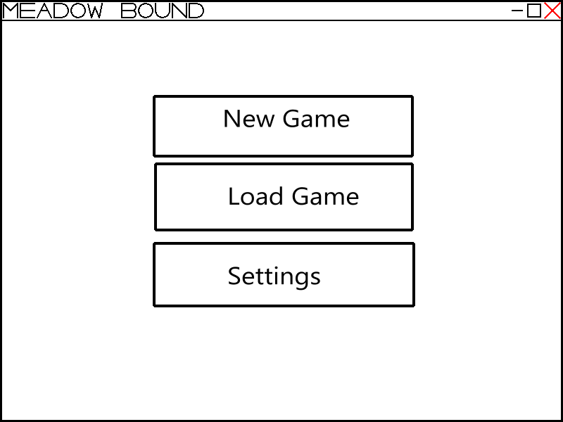
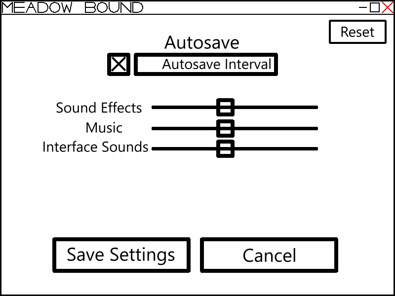
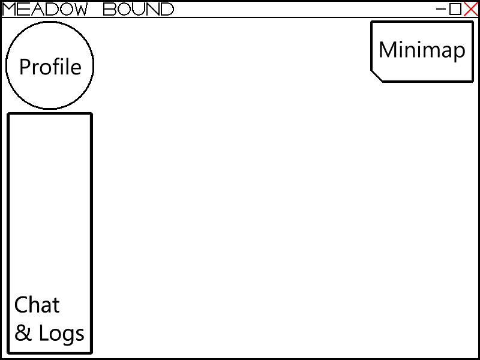
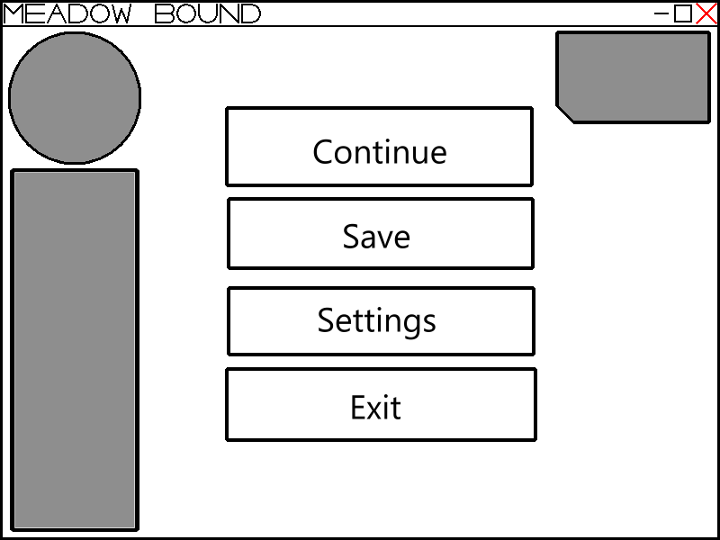
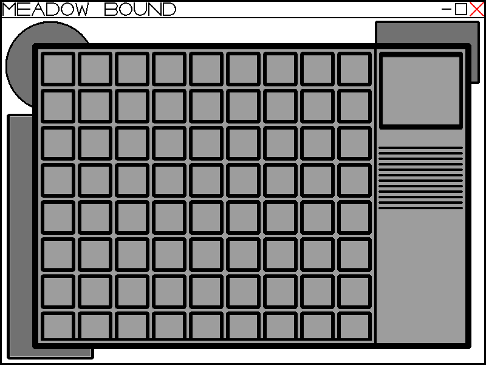
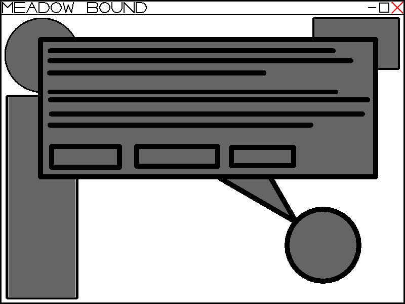

# Dernières recherches sur les données pour la base du projet - Jour 4

Tout est présent et claire dans les points suivants

## Méthodologie de projet

- [Méthodologie](./Day2-technical-doc-base.fr.md#1-description-de-la-méthodologie) 
- [Raison](./Day2-technical-doc-base.fr.md#2-pourquoi-cette-méthodologie-est-adaptée-au-projet)

## Environnement de développement

- [Langage de programmation](./Day2-technical-doc-base.fr.md#1-langage-de-programmation--c)
- [Framework spécifique](./Day2-technical-doc-base.fr.md#2-framework-de-jeu--monogame)
- [Gestion de version GIT](./Day2-technical-doc-base.fr.md#3-gestion-des-versions--git-et-github)
- [Stockage des données](./Day2-technical-doc-base.fr.md#4-stockage-des-données--json-envisagé)
  - [Format envisagé](./Day3-technical-doc-missing-from-day2.fr.md#stockage-des-données---format-json)
- [Organisation du code](./Day2-technical-doc-base.fr.md#5-organisation-du-code)

## Maquettes prévisionnelles

**Menu Principal**

**Paramètres**

**Interface de jeu**

**Menu de pause**

**Inventaire**

**Interaction avec pnj**

