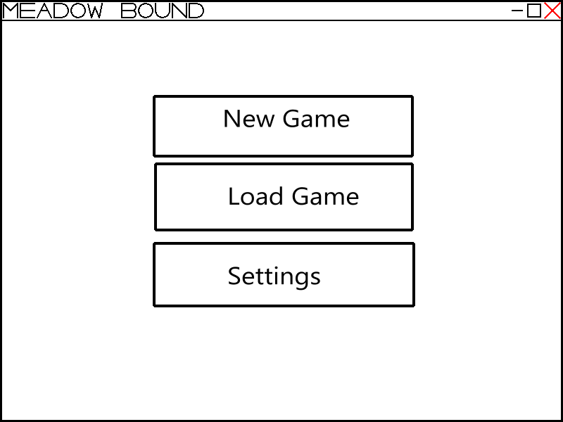
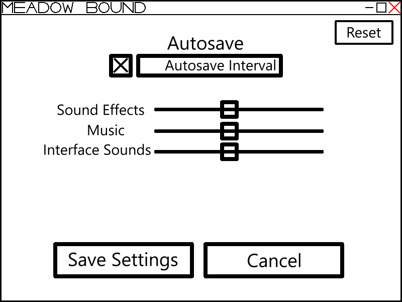
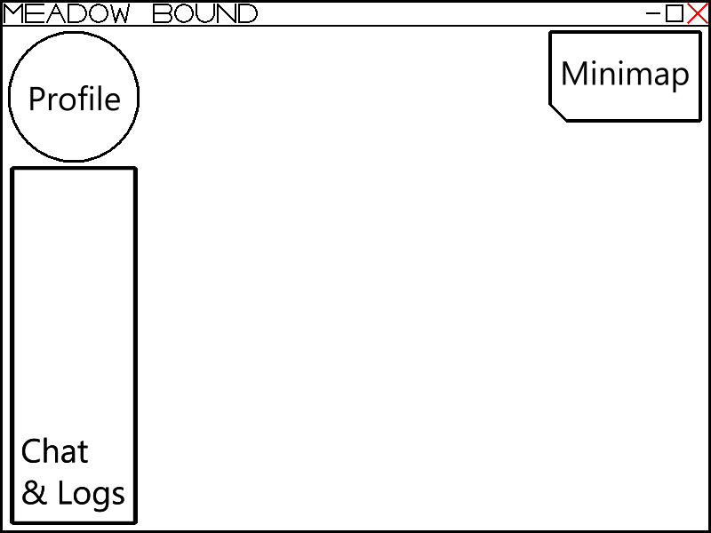
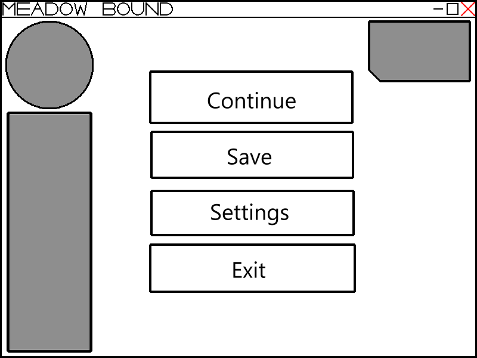
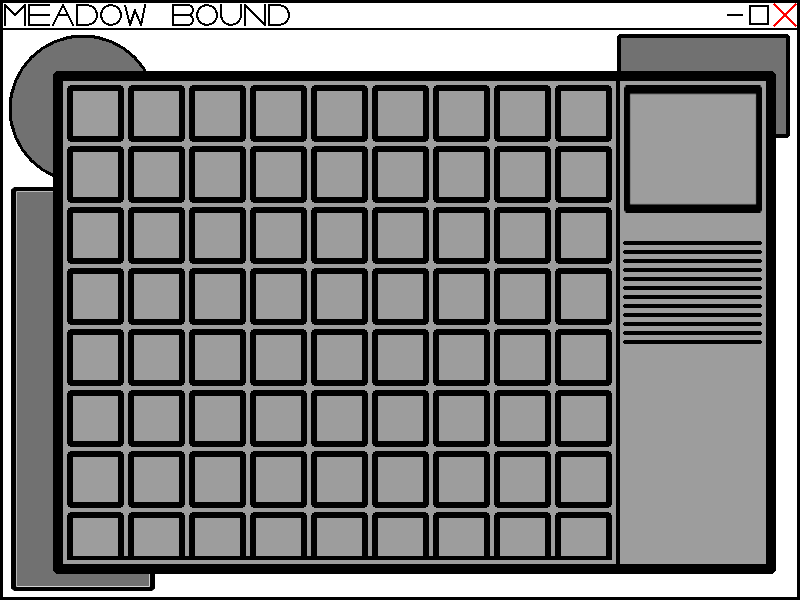
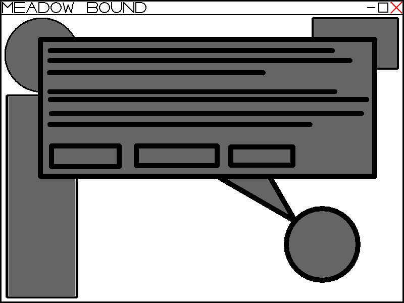

# Journal de bord - Projet Meadowbound

Développement d'un jeu de farming en monde ouvert 2.5D avec C# et MonoGame

## Jour 1 - Analyse du besoin et définition du projet

**Temps de travail**: 
180 min / 3 heures

**Objectif**:
Cadrage / Besoin et périmètre

### 1. Objectif de la journée

Cette première journée a été consacrée à la définition des bases du projet Meadowbound. L'objectif était de préciser le besoin auquel répond le jeu, les fonctionnalités envisagées, les technologies à utiliser et les principales étapes de développement.

Une attention particulière a été portée à la définition d'un MVP (Minimum Viable Product), afin de limiter le périmètre initial et de disposer d'une première version jouable avant d'envisager des fonctionnalités plus avancées.

### 2. Déroulement de la journée

| Activité                  | Travail effectué                                                                   | Durée   |
| ------------------------- | ---------------------------------------------------------------------------------- | ------- |
| Analyse du besoin         | Définition de la situation, des objectifs et du périmètre du projet.               | 30 min  |
| Définition du MVP         | Identification et priorisation des fonctionnalités indispensables.                 | 35 min  |
| Conception de la solution | Réflexion sur les écrans, la perspective 2.5D, l'architecture et les technologies. | 40 min  |
| Organisation du projet    | Identification des étapes de développement, des risques et des besoins de gestion. | 30 min  |
| Documentation             | Structuration du document, rédaction et identification des sources.                | 25 min  |
| Bilan et préparation      | Synthèse des décisions et définition des travaux à poursuivre.                     | 20 min  |
| Total                     |                                                                                    | 180 min |

### 3. Travaux réalisés

Le projet a été défini comme un jeu de simulation agricole en monde ouvert, développé en C# avec MonoGame. Le joueur pourra développer sa ferme, cultiver des plantes et explorer un environnement représenté en 2.5D.

Le périmètre initial a été orienté vers les mécaniques essentielles : affichage de la carte, déplacements, caméra, collisions, agriculture, inventaire et sauvegarde. Les fonctionnalités secondaires, comme le commerce, les personnages non joueurs et les systèmes avancés, ont été réservées aux versions ultérieures.

Les premières orientations techniques ont également été définies. MonoGame permettra de gérer le rendu et les entrées du joueur, tandis que Git et GitHub serviront respectivement au suivi des versions et à l'organisation du travail.

Enfin, les principaux risques ont été identifiés, notamment la gestion de la perspective 2.5D, les collisions, la complexité de l'architecture et le risque d'élargissement excessif du périmètre.

### 4. Résultats obtenus

- Définition du concept général de Meadowbound.
- Première délimitation du périmètre du projet.
- Identification et priorisation des fonctionnalités du MVP.
- Définition des premières orientations techniques.
- Élaboration d'une première estimation du planning.
- Mise en place de la base de la documentation technique.

### 5. Difficultés et points de vigilance

La principale difficulté concerne l'équilibre entre les ambitions du jeu et le temps disponible. Un jeu de farming comprend de nombreux systèmes qui dépendent les uns des autres. Il est donc nécessaire de construire une base technique stable avant de développer les fonctionnalités plus complexes.

La perspective 2.5D représente également un point de vigilance, notamment pour la gestion des collisions et l'affichage des éléments selon leur profondeur.

Le planning reste provisoire : la durée totale du projet devra être précisée en fonction de l'avancement et des difficultés rencontrées.

### 6. Bilan de la journée

Cette première journée a permis de définir une direction claire pour le projet et de poser les bases du cahier des charges. Le MVP constitue désormais la référence pour les premières étapes du développement.

Les choix effectués devront être confirmés progressivement par des essais techniques. Il reste notamment à organiser l'environnement de développement, à structurer le dépôt GitHub et à détailler les tâches nécessaires à la réalisation du jeu.

### 7. Prochaines étapes

- Définir la méthodologie de gestion du projet.
- Préparer l'environnement de développement.
- Organiser le dépôt GitHub.
- Décrire et justifier les choix techniques.
- Transformer les fonctionnalités en tâches distinctes.
- Commencer la planification détaillée.

## Jour 2 - Méthodologie, environnement technique et planification

**Temps de travail**:
180 min / 3 heures

**Objectif**:
Organisation / Outils et tâches

### 1. Objectif de la journée

Cette deuxième journée a été consacrée à l'organisation du développement de Meadowbound. L'objectif était de définir une méthodologie adaptée à un projet individuel, de justifier les principaux choix techniques et de préparer le suivi des tâches à l'aide de GitHub.

Le travail a également porté sur l'identification des fonctionnalités prioritaires, la préparation d'une première planification et la mise en place du journal de bord pour suivre l'avancement du projet.

### 2. Déroulement de la journée

| Activité                       | Travail effectué                                                                                 | Durée   |
| ------------------------------ | ------------------------------------------------------------------------------------------------ | ------- |
| Méthodologie de projet         | Définition de l'approche Agile simplifiée et du développement par composants et vertical slices. | 25 min  |
| Environnement de développement | Description de l'environnement C#, MonoGame, Git et GitHub.                                      | 25 min  |
| Choix techniques               | Justification des technologies et réflexion sur le stockage des données.                         | 30 min  |
| Définition des fonctionnalités | Formalisation du MVP, des priorités et des critères de validation.                               | 35 min  |
| Backlog GitHub                 | Préparation de la répartition des fonctionnalités en issues distinctes.                          | 25 min  |
| Planification                  | Définition des premières étapes et des objectifs hebdomadaires.                                  | 20 min  |
| Journal de bord                | Définition de la structure de suivi quotidien.                                                   | 20 min  |
| Total                          |                                                                                                  | 180 min |

### 3. Travaux réalisés

Une méthodologie adaptée au développement individuel a été définie. Elle combine une organisation par composants, une approche Agile simplifiée et la réalisation de vertical slices. Cette organisation doit permettre de développer progressivement des ensembles de fonctionnalités cohérents, puis de vérifier leur fonctionnement dans le jeu.

L'environnement technique a été décrit autour de C# et MonoGame pour le développement, de Git pour le suivi des versions et de GitHub pour l'hébergement du code et la gestion des tâches.

Les principaux choix techniques ont été justifiés. C# permet de structurer le code, tandis que MonoGame offre la liberté nécessaire pour concevoir l'architecture du jeu. Le format JSON a été envisagé pour certaines données et les sauvegardes, sous réserve de confirmer son adéquation aux besoins définitifs.

Le périmètre du MVP a ensuite été détaillé. Les fonctionnalités indispensables ont été classées en priorité P0, tandis que les fonctionnalités pouvant être reportées ont été classées en P1. Une boucle de jeu complète a été retenue comme critère global de validation : se déplacer, préparer le sol, planter, attendre la croissance, récolter, sauvegarder et reprendre sa partie.

Enfin, la gestion des tâches a été préparée autour de GitHub Issues. Le principe retenu est de créer une issue par tâche identifiable, avec un objectif précis et un critère de validation. Une première planification hebdomadaire a également été définie, avec l'objectif de disposer d'une version fonctionnelle à la fin de chaque cycle.

### 4. Résultats obtenus

- Définition de la méthodologie de développement.
- Description de l'environnement technique.
- Justification des principaux choix technologiques.
- Formalisation du MVP et de ses critères de validation.
- Préparation de l'organisation du backlog GitHub.
- Première ébauche de la planification.
- Définition de la structure du journal de bord.

### 5. Difficultés et points de vigilance

Le principal enjeu consiste à conserver une architecture suffisamment claire sans consacrer trop de temps à la conception avant d'obtenir un résultat concret. L'approche par composants et les vertical slices devront donc être appliquées de manière pragmatique.

La planification reste également dépendante de la difficulté réelle des premières fonctionnalités. Il faudra éviter de considérer les estimations initiales comme des échéances définitives.

Enfin, le backlog devra être maintenu à jour : les tâches terminées devront être validées, tandis que les difficultés rencontrées pourront conduire à créer de nouvelles issues ou à revoir les priorités.

### 6. Bilan de la journée

Cette deuxième journée a permis de préciser l'organisation technique et méthodologique du projet. Les principales fonctionnalités sont désormais identifiées, les outils de développement sont définis et une première structure de suivi du travail est prévue.

La prochaine étape consistera à passer de la préparation à la réalisation concrète. Il faudra notamment vérifier l'environnement MonoGame, initialiser ou finaliser le dépôt GitHub, créer les issues prioritaires et commencer le développement d'une première version affichant une carte.

### 7. Prochaines étapes

- Vérifier la configuration de l'environnement C# et MonoGame.
- Initialiser ou finaliser le dépôt GitHub.
- Créer les issues correspondant aux premières tâches.
- Définir la structure initiale du code.
- Réaliser une première carte de test.
- Vérifier l'affichage et le fonctionnement général du projet.
- Mettre à jour le backlog et le journal de bord après chaque session.

## Jour 3 - Approfondissement des choix techniques et planification des fonctionnalités — Meadowbound

**Temps de travail**:
180 min / 3 heures

**Objectif**:
Approfondissement / JSON et planning

### 1. Objectif de la journée

Cette troisième journée a été consacrée à l'approfondissement de certains éléments techniques et organisationnels qui n'avaient pas été entièrement définis lors de la journée précédente.

Le premier objectif était de préciser l'utilisation du format JSON pour le stockage des données du jeu. Il s'agissait notamment d'identifier les différentes catégories de données, de proposer une organisation des fichiers et de réfléchir à leur utilisation dans le fonctionnement de Meadowbound.

Le deuxième objectif était de compléter la planification des fonctionnalités afin de disposer d'une meilleure vision des étapes de développement, de leurs dépendances et de leur ordre de réalisation.

### 2. Déroulement de la journée

| Activité                          | Travail effectué                                                                         | Durée   |
| --------------------------------- | ---------------------------------------------------------------------------------------- | ------- |
| Approfondissement du JSON         | Réflexion sur les structures de données et les différents fichiers nécessaires.          | 45 min  |
| Organisation des données          | Séparation des données du monde, du joueur, des paramètres et des ressources.            | 25 min  |
| Analyse technique                 | Identification des limites, des risques et des améliorations possibles du stockage JSON. | 25 min  |
| Planification des fonctionnalités | Définition des grandes étapes et de leur ordre de réalisation.                           | 45 min  |
| Organisation des tâches           | Réflexion sur la répartition des fonctionnalités en tâches GitHub.                       | 20 min  |
| Documentation                     | Rédaction et mise en forme des éléments étudiés.                                         | 20 min  |
| Total                             |                                                                                          | 180 min |

### 3. Travaux réalisés

#### 3.1. Approfondissement du stockage des données avec JSON

Le format JSON a été étudié plus précisément afin de déterminer comment organiser les données nécessaires au fonctionnement du jeu.

Plusieurs fichiers ont été envisagés, chacun ayant une responsabilité particulière.

Les structures proposées sont les suivantes :

| Fichier                | Utilisation prévue                                                        |
| ---------------------- | ------------------------------------------------------------------------- |
| `world.json`           | Stockage des informations relatives au monde et à la carte.               |
| `players.json`         | Stockage des informations du joueur, de sa position et de son inventaire. |
| `settings.json`        | Stockage des paramètres de configuration du jeu.                          |
| `achievements.json`    | Définition des succès disponibles.                                        |
| `resources-types.json` | Définition des différents types de ressources.                            |
| `textures.json`        | Association entre les identifiants des textures et leurs chemins d'accès. |

Des exemples de structures JSON ont été préparés pour illustrer l'organisation envisagée. Ils constituent une première proposition et pourront évoluer en fonction des besoins rencontrés pendant le développement.

Une distinction devra notamment être conservée entre les données statiques, qui définissent les éléments du jeu, et les données dynamiques, qui évoluent pendant une partie.

Par exemple, les types de ressources et les définitions des cultures pourront être considérés comme des données statiques, tandis que les quantités présentes dans l'inventaire et l'état des parcelles devront être enregistrés dans la sauvegarde du joueur.

#### 3.2. Organisation et limites du stockage JSON

L'utilisation de JSON présente plusieurs avantages pour le projet :

- Les fichiers sont lisibles et facilement modifiables.
- Les données peuvent être organisées sous forme d'objets et de tableaux.
- Le format est compatible avec C#.
- Il facilite le débogage et l'inspection des sauvegardes.
- Il permet de séparer les données du code source.

Cependant, plusieurs précautions devront être prises.

Il faudra notamment prévoir une gestion des erreurs lorsqu'un fichier est absent, illisible ou contient des données incorrectes. La compatibilité des sauvegardes devra également être prise en compte si la structure des données évolue pendant le développement.

Pour limiter les risques, il sera préférable de prévoir une version du format de sauvegarde et de vérifier les données lors de leur chargement.

Enfin, les chemins des textures devront être centralisés et associés à des identifiants cohérents afin d'éviter de disperser les chemins d'accès dans le code.

#### 3.3. Approfondissement de la planification

La planification des fonctionnalités a été identifiée comme un élément à compléter pour mieux organiser le développement.

L'objectif est de répartir les fonctionnalités du MVP en plusieurs étapes successives, en tenant compte de leurs dépendances techniques.

La priorité sera donnée aux fondations du jeu : initialisation du projet, affichage de la carte, déplacements, caméra et collisions.

Les systèmes agricoles et les fonctionnalités de gestion seront ensuite développés progressivement.

Une première proposition de planning a été préparée pour servir de base au document de planification.

### 4. Première proposition de planning des fonctionnalités

Le planning a été organisé par grandes étapes de développement. Chaque étape doit aboutir à un résultat concret et vérifiable.

Les fonctionnalités seront développées progressivement, en privilégiant les dépendances techniques : il est préférable de disposer d'une carte fonctionnelle avant de développer les interactions avec celle-ci.

| Période    | Fonctionnalités prévues                                                                                  | Résultat attendu                                                 |
| ---------- | -------------------------------------------------------------------------------------------------------- | ---------------------------------------------------------------- |
| Semaine 1  | Initialisation MonoGame, configuration du projet, organisation du code et affichage d'une carte de test. | Première version exécutable avec une carte.                      |
| Semaine 2  | Création du joueur, gestion des entrées et déplacements.                                                 | Personnage contrôlable sur la carte.                             |
| Semaine 3  | Caméra 2.5D, collisions et gestion de la profondeur d'affichage.                                         | Déplacements cohérents dans l'environnement.                     |
| Semaine 4  | Interactions avec les éléments du monde et gestion des parcelles.                                        | Possibilité d'interagir avec l'environnement.                    |
| Semaine 5  | Préparation du sol, plantation et gestion des graines.                                                   | Première mécanique agricole fonctionnelle.                       |
| Semaine 6  | Croissance des cultures et récolte.                                                                      | Cycle agricole fonctionnel.                                      |
| Semaine 7  | Inventaire et gestion des ressources.                                                                    | Stockage et consultation des objets récoltés.                    |
| Semaine 8  | Sauvegarde et chargement des données avec JSON.                                                          | Conservation de la progression.                                  |
| Semaine 9  | Interface utilisateur et amélioration de l'expérience de jeu.                                            | Interface permettant d'utiliser les fonctionnalités principales. |
| Semaine 10 | Tests, corrections et stabilisation du MVP.                                                              | Première version jouable et testée.                              |

Estimation prévisionnelle : 10 semaines. Cette durée reste indicative et devra être ajustée en fonction du temps disponible, des difficultés techniques et des résultats obtenus. Chaque journée de travail correspond à une session de 180 minutes.

#### 4.1. Organisation des priorités

Les fonctionnalités seront développées selon trois niveaux de priorité :

- P0 — Indispensable : fonctionnalités nécessaires à la réalisation du MVP.
- P1 — Importante : améliorations utiles pouvant être intégrées après validation des systèmes essentiels.
- P2 — Secondaire : fonctionnalités supplémentaires pouvant être reportées à des versions ultérieures.

Cette classification permettra de conserver un périmètre maîtrisé et d'éviter que des fonctionnalités secondaires retardent la réalisation du MVP.

#### 4.2. Dépendances entre les fonctionnalités

Certaines fonctionnalités nécessitent que d'autres systèmes soient déjà opérationnels.

Par exemple :

- Les déplacements nécessitent une carte et un système de gestion des entrées.
- Les collisions nécessitent une représentation des obstacles.
- Les interactions agricoles nécessitent un système de parcelles.
- La plantation nécessite une gestion des graines.
- La récolte nécessite un système de croissance.
- L'inventaire nécessite une gestion des ressources.
- Les sauvegardes nécessitent une structure de données stable.

Ces dépendances devront être prises en compte lors de la création des issues GitHub et de la répartition du travail.

### 5. Points de vigilance

Plusieurs éléments devront être surveillés pendant le développement.

Stockage des données : il faudra éviter de mélanger les paramètres du jeu, les définitions des ressources et les données propres à une partie sauvegardée.

Évolution des fichiers JSON : les structures pourront changer au cours du développement. Il faudra donc prévoir une gestion des versions des sauvegardes.

Complexité du projet : certaines fonctionnalités peuvent nécessiter davantage de temps que prévu. Le planning devra rester adaptable.

Dépendances techniques : le développement des fonctionnalités devra respecter un ordre logique pour éviter de devoir modifier plusieurs systèmes déjà réalisés.

Périmètre du MVP : les fonctionnalités secondaires ne devront pas prendre le dessus sur les éléments indispensables à la première version jouable.

### 6. Bilan de la journée

Cette troisième journée a permis d'approfondir les choix concernant le stockage des données et de proposer une organisation plus précise des fichiers JSON.

La séparation des données du monde, du joueur, des paramètres et des ressources constitue une première base pour la future architecture du jeu.

Le travail sur la planification a également permis de répartir les fonctionnalités du MVP en grandes étapes de développement. Un premier calendrier prévisionnel de dix semaines a été proposé, avec des objectifs concrets pour chaque période.

Ces éléments permettront de mieux organiser les prochaines tâches et de préparer leur intégration dans le backlog GitHub.

### 7. Prochaines étapes

- Finaliser la structure des fichiers JSON.
- Définir les classes C# correspondant aux principales données.
- Compléter le fichier de planification.
- Créer les issues GitHub correspondant aux fonctionnalités prioritaires.
- Vérifier et préparer l'environnement MonoGame.
- Commencer l'initialisation technique du jeu.
- Réaliser le premier affichage de la carte.

## Jour 4 - Recherches complémentaires et conception prévisionnelle des interfaces — Meadowbound

**Temps de travail**:
180 min / 3 heures

**Objectif**:
Conception / Documentation et maquettes

### 1. Objectif de la journée

Cette quatrième journée a été consacrée à la consolidation de la documentation technique et à la préparation de la conception visuelle de Meadowbound.

Les recherches précédentes concernant la méthodologie, l'environnement de développement et les choix techniques ont été reprises afin de vérifier que les informations nécessaires à la compréhension du projet étaient présentes et correctement documentées.

Une attention particulière a également été portée aux maquettes prévisionnelles des interfaces. L'objectif était d'identifier les principaux écrans du jeu et de définir une première organisation visuelle des éléments qui seront accessibles au joueur.

### 2. Déroulement de la journée

| Activité                        | Travail effectué                                                                     | Durée   |
| ------------------------------- | ------------------------------------------------------------------------------------ | ------- |
| Vérification de la méthodologie | Relecture et vérification de la méthodologie et de sa justification.                 | 10 min  |
| Vérification de l'environnement | Vérification des choix concernant C#, MonoGame, Git, JSON et l'organisation du code. | 15 min  |
| Organisation documentaire       | Vérification des liens internes et de la cohérence entre les différents documents.   | 10 min  |
| Conception des maquettes        | Préparation et étude des différents écrans du jeu.                                   | 115 min |
| Analyse des interfaces          | Identification des éléments fonctionnels et des interactions nécessaires.            | 20 min  |
| Documentation et bilan          | Organisation des maquettes et rédaction du journal de bord.                          | 10 min  |
| Total                           |                                                                                      | 180 min |

### 3. Travaux réalisés

#### 3.1. Vérification de la méthodologie de projet

La méthodologie définie lors de la deuxième journée a été reprise afin de vérifier que les éléments nécessaires à la compréhension de l'organisation du développement étaient présents.

Les deux approches retenues, Component-Driven Truncated Agile et Architecture-First Vertical Slice, sont documentées avec leurs principes et les raisons justifiant leur utilisation dans le cadre du projet.

Les documents correspondants ont été référencés afin de faciliter leur consultation depuis la documentation principale.

#### 3.2. Vérification de l'environnement de développement

Les différents choix techniques ont également été repris.

Les éléments suivants sont désormais regroupés dans la documentation technique :

- C# : langage utilisé pour développer le jeu.
- MonoGame : framework utilisé pour le rendu graphique, les entrées et les autres fonctionnalités nécessaires.
- Git et GitHub : outils de suivi des versions et d'organisation du développement.
- JSON : format envisagé pour le stockage des données et des sauvegardes.
- Organisation du code : séparation des responsabilités en composants et systèmes distincts.

Les exemples de structures JSON réalisés lors de la troisième journée ont également été référencés afin de conserver une trace des premières orientations concernant le stockage des données.

Cette vérification permet de disposer d'une documentation technique regroupant les principaux choix effectués avant le début de l'implémentation.

#### 3.3. Conception des maquettes prévisionnelles

Un travail de conception visuelle a été réalisé afin d'anticiper l'organisation des interfaces de Meadowbound.

Plusieurs écrans ont été identifiés. Ils représentent les principales situations dans lesquelles le joueur pourra interagir avec le jeu.

L'objectif de ces maquettes est de disposer d'une référence visuelle avant leur intégration technique. Elles pourront évoluer au cours du développement en fonction des besoins et des contraintes rencontrées.

##### Menu principal

Le menu principal constituera le point d'entrée du jeu. Il devra permettre au joueur d'accéder aux principales options, notamment le lancement d'une partie, le chargement d'une sauvegarde, les paramètres et la fermeture du jeu.

##### Paramètres

L'écran des paramètres permettra de modifier les principales options de configuration, comme le volume sonore, la musique, les commandes et les paramètres graphiques.

##### Interface de jeu

L'interface de jeu représentera l'environnement principal dans lequel évoluera le joueur. Elle devra afficher les informations utiles sans masquer excessivement la zone de jeu.

Les éléments envisagés comprennent notamment les informations du joueur, les raccourcis d'actions et l'accès aux fonctionnalités principales.

##### Menu de pause

Le menu de pause permettra de suspendre temporairement la partie et d'accéder à différentes options, comme reprendre le jeu, consulter les paramètres ou revenir au menu principal.

##### Inventaire

L'inventaire permettra de consulter les ressources et les objets collectés pendant la partie. Il devra également permettre de connaître les quantités disponibles et de préparer les futures interactions avec les objets.

##### Interaction avec les PNJ

Cette interface est prévue pour les interactions avec les personnages non joueurs. Elle pourra permettre d'afficher des dialogues, des informations et éventuellement des choix de réponse.

Cette fonctionnalité n'est pas indispensable au MVP et pourra être développée dans une version ultérieure.

#### 3.4. Analyse fonctionnelle des interfaces

L'étude des maquettes a permis d'identifier plusieurs besoins fonctionnels qui devront être pris en compte pendant le développement.

| Interface                | Fonction principale                               | Priorité envisagée |
| ------------------------ | ------------------------------------------------- | ------------------ |
| Menu principal           | Navigation entre les différentes options du jeu.  | P0                 |
| Paramètres               | Configuration des options principales.            | P1                 |
| Interface de jeu         | Affichage du monde et des informations du joueur. | P0                 |
| Menu de pause            | Suspension et reprise de la partie.               | P1                 |
| Inventaire               | Consultation et gestion des ressources.           | P0                 |
| Interaction avec les PNJ | Affichage des dialogues et interactions.          | P2                 |

Ces interfaces devront être développées progressivement. Leur organisation devra rester cohérente avec l'architecture générale du jeu et permettre de séparer l'affichage graphique de la logique fonctionnelle.

### 4. Résultats obtenus

À l'issue de cette journée, les éléments suivants ont été préparés :

- Vérification de la documentation méthodologique.
- Vérification des principaux choix techniques.
- Référencement des exemples de structures JSON.
- Organisation des liens internes entre les documents.
- Identification des six interfaces principales.
- Première définition des besoins fonctionnels associés aux interfaces.
- Classement prévisionnel des interfaces selon leur priorité.
- Préparation des bases de la future implémentation graphique.

### 5. Difficultés et points de vigilance

La principale difficulté concerne la cohérence entre les maquettes et les fonctionnalités réellement prévues dans le MVP.

Il faudra éviter de développer des interfaces dont les fonctionnalités ne sont pas encore disponibles. L'interface graphique devra évoluer en même temps que les systèmes du jeu.

Un autre point de vigilance concerne l'organisation de l'affichage en 2.5D. Les interfaces devront rester lisibles et indépendantes de la caméra du monde de jeu.

Enfin, les maquettes représentent une proposition de conception et ne constituent pas une version définitive. Certains éléments pourront être modifiés lorsque les premières interfaces seront intégrées dans MonoGame.

### 6. Bilan de la journée

Cette quatrième journée a permis de consolider les éléments documentaires préparés précédemment et de compléter la phase de conception avec une première représentation des interfaces de Meadowbound.

Les choix méthodologiques et techniques sont désormais regroupés dans la documentation, tandis que les principales interfaces ont été identifiées et associées à leurs fonctions.

Le projet dispose ainsi d'une base documentaire plus complète pour commencer son développement. Les prochaines étapes pourront se concentrer davantage sur la préparation concrète de l'environnement de travail et sur l'implémentation des premiers systèmes.

### 7. Prochaines étapes

- Finaliser la documentation technique.
- Vérifier la cohérence entre le MVP et les maquettes.
- Finaliser le planning de développement.
- Organiser les fonctionnalités sous forme d'issues GitHub.
- Préparer l'architecture initiale du projet MonoGame.
- Commencer l'implémentation du menu principal ou de l'affichage de la carte.
- Vérifier le fonctionnement de la première version exécutable.

## Jour 5 - Initialisation du projet et création de l'environnement MonoGame — Meadowbound

**Temps de travail**:
180 min / 3 heures

**Issues concernées**:
#9 et #10 / Architecture et MonoGame

### 1. Objectif de la journée

Cette cinquième journée marque le début de la réalisation technique de Meadowbound.

Après les différentes étapes de préparation, l'objectif était de commencer à mettre en place les fondations du projet. Le travail a principalement porté sur l'initialisation de son architecture et la création du projet MonoGame en C#.

Il s'agissait de disposer d'une première base de développement sur laquelle les différents systèmes du jeu pourront être construits progressivement.

### 2. Déroulement de la journée

| Activité                        | Travail effectué                                                                          | Durée   |
| ------------------------------- | ----------------------------------------------------------------------------------------- | ------- |
| Initialisation du projet        | Préparation de la base du projet et de son environnement de développement.                | 35 min  |
| Configuration MonoGame          | Création et configuration du projet C# avec MonoGame.                                     | 45 min  |
| Première organisation technique | Réflexion sur la structure générale et les éléments nécessaires au fonctionnement du jeu. | 35 min  |
| Vérifications initiales         | Contrôle de la configuration et des dépendances du projet.                                | 30 min  |
| Documentation                   | Mise à jour des informations techniques et du suivi des tâches.                           | 15 min  |
| Bilan                           | Synthèse des travaux et préparation de la suite.                                          | 20 min  |
| Total                           |                                                                                           | 180 min |

### 3. Travaux réalisés

#### 3.1. Initialisation du projet et de son architecture

La première tâche a consisté à commencer l'initialisation de Meadowbound en préparant une base technique destinée à accueillir les différents systèmes du jeu.

L'organisation générale a été pensée pour respecter les principes définis lors des journées précédentes, notamment la séparation des responsabilités et le développement par composants.

L'objectif est d'éviter de regrouper toute la logique du jeu dans une seule classe et de conserver une architecture suffisamment évolutive pour intégrer les fonctionnalités futures.

Issue concernée : [#1 — Initialiser le projet et son architecture](https://github.com/Mommy-Of-Light/Meadowbound/issues/1).

#### 3.2. Création et configuration du projet MonoGame en C\#

Le projet MonoGame a ensuite été préparé avec le langage C#.

Cette étape constitue la base de l'environnement d'exécution du jeu. MonoGame fournira notamment les mécanismes nécessaires à l'initialisation du jeu, au rendu graphique, à la gestion des entrées et au chargement des ressources.

Une attention particulière a été portée à la configuration initiale afin de disposer d'un environnement adapté aux développements suivants.

Issue concernée : [#9 — Créer et configurer le projet MonoGame en C#](https://github.com/Mommy-Of-Light/Meadowbound/issues/9).

#### 3.3. Organisation générale de la base technique

Une première réflexion a également été menée sur la manière dont les futurs systèmes seront intégrés au projet.

Les principaux éléments à prévoir sont notamment :

- La gestion générale du jeu.
- Le rendu graphique.
- La gestion des entrées du joueur.
- Le chargement des ressources.
- La représentation du monde.
- La gestion du joueur et de ses interactions.

Cette réflexion servira de base au travail d'organisation plus détaillé prévu lors de la prochaine journée.

Issue concernée : [#10 — Définir l'organisation des dossiers et namespaces](https://github.com/Mommy-Of-Light/Meadowbound/issues/10).

### 4. Résultats obtenus

- Première initialisation de la base du projet Meadowbound.
- Préparation de l'environnement MonoGame.
- Création et configuration du projet C#.
- Première réflexion sur l'architecture générale.
- Identification des principaux systèmes à intégrer.
- Préparation de la suite de l'organisation technique.

### 5. Difficultés et points de vigilance

La principale difficulté de cette étape réside dans la définition d'une architecture suffisamment claire sans anticiper inutilement toutes les fonctionnalités futures.

Il faudra notamment éviter de créer des dépendances trop importantes entre les différents systèmes.

La configuration de MonoGame devra également être vérifiée régulièrement afin de détecter rapidement les éventuels problèmes liés aux dépendances, à la compilation ou à l'exécution.

### 6. Bilan de la journée

Cette cinquième journée a permis d'entamer concrètement le développement de Meadowbound.

Les premières fondations techniques ont été préparées et le projet MonoGame a été créé et configuré. Le travail réalisé constitue le point de départ de l'organisation interne du code.

La prochaine étape consistera à préciser cette organisation en définissant les dossiers, les namespaces et les responsabilités des principaux composants.

### 7. Prochaines étapes

- Définir l'organisation des dossiers et des namespaces.
- Identifier les responsabilités des principaux composants.
- Préparer le système de chargement des ressources.
- Vérifier la compilation et le démarrage du projet.

## Jour 6 - Organisation de l'architecture, composants et chargement des ressources — Meadowbound

**Temps de travail**:
180 min / 3 heures

**Issues concernées**:
#10 à #13 / Architecture et vérifications

### 1. Objectif de la journée

Cette sixième journée a été consacrée à la structuration interne du projet et à la préparation des principaux mécanismes techniques nécessaires à son fonctionnement.

Après la création du projet MonoGame lors de la journée précédente, l'objectif était de définir une organisation claire du code, d'identifier les responsabilités des principaux composants et de préparer le chargement des ressources du jeu.

Une dernière étape devait permettre de vérifier que le projet pouvait être compilé et démarré correctement.

### 2. Déroulement de la journée

| Activité                       | Travail effectué                                                     | Durée   |
| ------------------------------ | -------------------------------------------------------------------- | ------- |
| Organisation des dossiers      | Définition de la structure des répertoires et des namespaces.        | 35 min  |
| Responsabilités des composants | Identification des rôles des principaux éléments de l'architecture.  | 35 min  |
| Chargement des ressources      | Préparation du mécanisme de gestion et de chargement des ressources. | 40 min  |
| Compilation et démarrage       | Vérification du fonctionnement général du projet.                    | 30 min  |
| Documentation                  | Mise à jour de la documentation technique et des issues.             | 20 min  |
| Bilan                          | Synthèse et préparation de la prochaine étape.                       | 20 min  |
| Total                          |                                                                      | 180 min |

### 3. Travaux réalisés

#### 3.1. Organisation des dossiers et des namespaces

La première partie du travail a porté sur l'organisation interne du code source.

L'objectif était de séparer les différentes catégories de fonctionnalités afin de faciliter la navigation dans le projet et de limiter le mélange des responsabilités.

Une organisation par domaines fonctionnels a été envisagée, avec notamment des espaces dédiés au monde, au joueur, aux interfaces, aux ressources et aux systèmes généraux du jeu.

Les namespaces devront suivre cette organisation afin de faciliter l'identification des classes et de leurs rôles.

Issue concernée : [#10 — Définir l'organisation des dossiers et namespaces](https://github.com/Mommy-Of-Light/Meadowbound/issues/10).

#### 3.2. Définition des responsabilités des principaux composants

La deuxième partie a consisté à identifier les responsabilités des principaux composants de l'architecture.

Cette séparation doit permettre de limiter les dépendances entre les systèmes et de faciliter les évolutions futures.

Les principaux éléments identifiés sont les suivants :

| Composant    | Responsabilité envisagée                       |
| ------------ | ---------------------------------------------- |
| Game         | Gestion du cycle de vie général du jeu.        |
| Renderer     | Affichage des éléments graphiques.             |
| InputManager | Gestion des entrées du joueur.                 |
| AssetManager | Chargement et accès aux ressources.            |
| World        | Représentation et gestion du monde.            |
| Player       | Données et comportements du joueur.            |
| Camera       | Gestion du point de vue et du suivi du joueur. |
| UI           | Gestion des interfaces utilisateur.            |

Cette répartition constitue une première proposition d'organisation. Les responsabilités exactes seront précisées au fur et à mesure de l'implémentation.

Issue concernée : [#11 — Définir les responsabilités des principaux composants](https://github.com/Mommy-Of-Light/Meadowbound/issues/11).

#### 3.3. Préparation du chargement des ressources du jeu

Le travail s'est ensuite concentré sur la gestion des ressources nécessaires au fonctionnement du jeu.

Les ressources concernées comprennent notamment :

- Les textures des éléments de la carte.
- Les textures du personnage.
- Les éléments graphiques de l'interface.
- Les ressources sonores.
- Les autres fichiers nécessaires à l'affichage du jeu.

L'objectif est de centraliser leur chargement afin d'éviter que chaque système gère individuellement ses propres fichiers.

Cette approche permettra également de faciliter l'évolution du contenu graphique et d'assurer une meilleure organisation des ressources.

Issue concernée : [#12 — Configurer le chargement des ressources du jeu](https://github.com/Mommy-Of-Light/Meadowbound/issues/12).

#### 3.4. Vérification de la compilation et du démarrage

La dernière partie du travail a été consacrée à la vérification du fonctionnement général du projet.

L'objectif était de s'assurer que la configuration réalisée lors des deux journées précédentes permettait de compiler et de lancer correctement l'application.

Cette vérification constitue une étape importante avant de commencer le développement des fonctionnalités visibles du jeu.

Elle permettra également de disposer d'une base exécutable sur laquelle les futurs systèmes pourront être intégrés progressivement.

Issue concernée : [#13 — Vérifier que le projet compile et démarre correctement](https://github.com/Mommy-Of-Light/Meadowbound/issues/13).

### 4. Résultats obtenus

- Définition de l'organisation des dossiers et des namespaces.
- Identification des responsabilités des principaux composants.
- Préparation du système de chargement des ressources.
- Vérification de la compilation du projet.
- Vérification du démarrage de l'application.
- Mise à jour de la documentation technique.
- Avancement des issues correspondant à l'architecture initiale.

### 5. Difficultés et points de vigilance

L'un des principaux enjeux de cette journée concerne la répartition des responsabilités entre les composants.

Une mauvaise séparation pourrait entraîner des dépendances trop importantes et rendre les modifications futures plus difficiles.

La gestion des ressources devra également être pensée pour éviter les chargements inutiles et faciliter leur réutilisation par les différents systèmes.

Enfin, la compilation et le démarrage du projet constituent uniquement une première validation technique. Il restera nécessaire de tester séparément les futurs systèmes et leurs interactions.

### 6. Bilan de la journée

Cette sixième journée a permis de poursuivre la mise en place des fondations techniques de Meadowbound.

L'organisation du code a été précisée, les responsabilités des principaux composants ont été identifiées et le chargement des ressources a été abordé.

La vérification de la compilation et du démarrage représente une étape importante, car elle permet de s'assurer que le projet dispose d'une base technique exploitable pour la suite du développement.

Les prochaines journées pourront désormais être davantage orientées vers la création des premiers éléments visibles du jeu, notamment la carte et son affichage.

### 7. Prochaines étapes

- Préparer les premières données de la carte.
- Définir la représentation des cases et des éléments du monde.
- Mettre en place le premier système de rendu de la carte.
- Charger et afficher les premières textures.
- Commencer à préparer la gestion des déplacements du joueur.
- Tester progressivement les interactions entre les composants.

## Jour 7 - Création du personnage joueur et implémentation des déplacements — Meadowbound

Temps de travail : 180 min / 3 heures

Issues concernées : [#16 — Créer le personnage joueur](https://github.com/Mommy-Of-Light/Meadowbound/issues/16) et [#17 — Implémenter les déplacements dans les quatre directions](https://github.com/Mommy-Of-Light/Meadowbound/issues/17)

### 1. Objectif de la journée

Cette septième journée a été consacrée à la création du personnage joueur et à la mise en place de ses premiers comportements.

À partir de l'architecture définie précédemment, l'objectif était d'intégrer le joueur dans le projet, de gérer ses déplacements dans les quatre directions et de préparer son affichage à l'écran.

Le travail a également porté sur la gestion des entrées clavier, les animations du personnage, l'équipement des outils et le suivi du joueur par la caméra.

### 2. Déroulement de la journée

| Activité                 | Travail effectué                                                                | Durée   |
| ------------------------ | ------------------------------------------------------------------------------- | ------- |
| Création du personnage   | Mise en place de la classe `Player` et de ses composants principaux.            | 30 min  |
| Gestion des déplacements | Implémentation des déplacements dans les quatre directions à partir du clavier. | 35 min  |
| Gestion des animations   | Création des animations d'attente, de marche et d'utilisation des outils.       | 40 min  |
| Gestion des équipements  | Intégration des textures du personnage et des outils.                           | 25 min  |
| Système de caméra        | Mise en place du suivi du personnage et du centrage de la caméra.               | 30 min  |
| Tests et documentation   | Vérification du fonctionnement et mise à jour des issues.                       | 20 min  |
| Total                    |                                                                                 | 180 min |

### 3. Travaux réalisés

#### 3.1. Création du personnage joueur

La première étape a consisté à créer le personnage principal de Meadowbound à travers une classe `Player`.

Cette classe s'appuie sur les composants définis dans l'architecture du projet afin de regrouper les informations nécessaires au fonctionnement du personnage.

Les principaux éléments intégrés comprennent :

- La position du personnage à travers son composant de transformation (`TransformComponent`).
- Les informations liées à ses déplacements (`MovementComponent`).
- La gestion de ses animations (`AnimationComponent`).
- La gestion de son équipement, notamment les vêtements et les outils.
- Les informations relatives à l'outil actuellement équipé et à son utilisation.

Cette organisation permet de séparer les données du personnage des systèmes chargés de traiter ses comportements.

Issue concernée : [#16 — Créer le personnage joueur](https://github.com/Mommy-Of-Light/Meadowbound/issues/16).

#### 3.2. Implémentation des déplacements dans les quatre directions

La deuxième étape a porté sur la gestion des déplacements du personnage.

Un `InputSystem` a été mis en place afin de récupérer les entrées du clavier et de déterminer la direction souhaitée par le joueur.

Les déplacements sont possibles dans les quatre directions principales :

- Haut : `W` ou `Flèche haut`.
- Bas : `S` ou `Flèche bas`.
- Gauche : `A` ou `Flèche gauche`.
- Droite : `D` ou `Flèche droite`.

Une gestion de l'ordre des pressions a également été ajoutée afin de privilégier la dernière direction pressée lorsque plusieurs touches de déplacement sont maintenues simultanément.

Le déplacement effectif est ensuite traité par un `MovementSystem`, qui actualise la position du personnage en fonction de sa vitesse et du temps écoulé entre deux mises à jour.

Cette approche permet d'obtenir un déplacement indépendant de la fréquence d'images du jeu.

Issue concernée : [#17 — Implémenter les déplacements dans les quatre directions](https://github.com/Mommy-Of-Light/Meadowbound/issues/17).

#### 3.3. Mise en place du système d'animations

Le travail s'est ensuite concentré sur l'intégration des animations du personnage à partir de ses spritesheets.

Un système d'animation a été développé afin de gérer plusieurs états :

| État        | Description                                   |
| ----------- | --------------------------------------------- |
| Idle        | Animation lorsque le personnage est immobile. |
| Walk        | Animation lorsque le personnage se déplace.   |
| Hoe         | Animation d'utilisation de la houe.           |
| WateringCan | Animation d'utilisation de l'arrosoir.        |

Une classe `AnimationClip` permet de définir les images constituant une animation, leur durée d'affichage et leur caractère répétitif ou non.

Le système prend également en compte la direction du personnage afin de sélectionner l'animation correspondant à son orientation.

Une gestion spécifique des séquences d'images a été ajoutée pour l'arrosoir, dont certaines étapes nécessitent de conserver la même image pendant plusieurs intervalles.

L'ensemble est coordonné par un `AnimationSystem`, qui sélectionne et actualise les animations en fonction des déplacements et des actions du joueur.

#### 3.4. Gestion des équipements et des outils

Une première gestion de l'équipement visuel du personnage a également été intégrée.

Les textures du corps, des vêtements et des outils sont chargées à partir du gestionnaire de contenu de MonoGame, puis associées aux différents emplacements de l'équipement du joueur.

Un dictionnaire basé sur une énumération `TextureType` permet de centraliser les textures chargées et de les retrouver selon leur catégorie.

La sélection des outils est réalisée au clavier :

- `1` : équiper la houe.
- `2` : équiper l'arrosoir.
- `0` : retirer l'outil équipé.
- `E` : utiliser l'outil sélectionné.

Le rendu du personnage repose sur la superposition de plusieurs couches graphiques, permettant d'afficher les différentes parties de son équipement.

#### 3.5. Mise en place du système de caméra

Enfin, un `CameraSystem` a été créé afin de suivre les déplacements du personnage.

La caméra calcule sa position à partir du centre du joueur, puis applique une transformation à l'affichage pour maintenir celui-ci au centre de l'écran.

Cette transformation est transmise au `SpriteBatch` de MonoGame lors du rendu.

Le système permet ainsi de déplacer le point de vue avec le personnage plutôt que de limiter ses déplacements à une zone fixe de l'écran.

Un affichage des coordonnées du joueur a également été conservé à des fins de débogage. Cet affichage est séparé de la transformation de la caméra afin de rester fixe à l'écran.

### 4. Résultats obtenus

- Création de la classe `Player` et intégration de ses principaux composants.
- Implémentation des déplacements dans les quatre directions.
- Gestion des entrées clavier et de la priorité de la dernière direction pressée.
- Mise en place des animations d'attente et de déplacement.
- Intégration des animations d'utilisation de la houe et de l'arrosoir.
- Chargement et association des textures du personnage et de ses équipements.
- Mise en place de la sélection et de l'utilisation des outils.
- Création d'un système de caméra permettant de suivre et de centrer le joueur.
- Vérification du fonctionnement des différents systèmes intégrés.

### 5. Difficultés et points de vigilance

L'une des principales difficultés rencontrées concerne la synchronisation entre les déplacements et les animations du personnage.

Il est nécessaire de s'assurer que l'animation affichée correspond toujours à l'état actuel du joueur et à sa direction.

La gestion des animations d'utilisation des outils demande également une attention particulière, notamment pour les séquences non répétitives et les images qui doivent rester affichées pendant plusieurs intervalles.

Un autre point important concerne la superposition des différentes couches graphiques. Les textures des vêtements et des outils doivent utiliser des coordonnées d'animation compatibles avec celles du personnage pour que leur affichage reste cohérent.

Enfin, le système de caméra devra évoluer avec la création du monde afin de prendre en compte les limites de la carte et d'éviter l'affichage des zones situées en dehors de celle-ci.

### 6. Bilan de la journée

Cette septième journée a permis de franchir une première étape importante dans le développement de Meadowbound : le personnage joueur est désormais intégré au projet et dispose de ses premiers comportements fonctionnels.

Les déplacements dans les quatre directions, les animations, la gestion des équipements et l'utilisation des outils constituent une première base pour les futures mécaniques de gameplay.

L'ajout du système de caméra permet également de préparer le jeu à un environnement plus vaste que la seule zone visible à l'écran.

L'architecture mise en place précédemment commence ainsi à être utilisée concrètement à travers l'interaction entre les différents systèmes.

### 7. Prochaines étapes

- Préparer les premières données représentant le monde.
- Définir la structure des cartes et des différentes cases.
- Développer le système de rendu de la carte.
- Intégrer les premières textures du décor.
- Adapter la caméra aux dimensions et aux limites du monde.
- Préparer les systèmes de collision afin de contrôler les déplacements du joueur.
- Tester les interactions entre le personnage et les éléments de l'environnement.